# AI Team Meeting Scheduler

**A conversational meeting scheduler built with n8n, OpenAI, Telegram, and Google Calendar.**

An employee can ask for a meeting with their team lead, revise the time in chat, and approve the final proposal. The workflow resolves the lead from the employee directory, enforces Cairo working hours, and checks the lead’s calendar again just before booking. The employee receives a Telegram confirmation and the lead receives an email.

[Workflow architecture](#workflow-architecture) · [Booking walkthrough](#booking-walkthrough) · [Run the project](#run-the-project) · [Importable workflow](workflow/ai-team-meeting-scheduler.json)

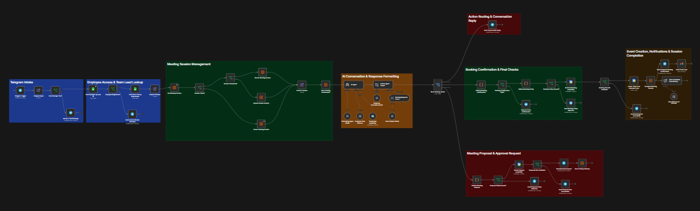

## Workflow architecture

The eight sections below follow the groups on the n8n canvas. Solid arrows show message flow. Dotted connections identify a model, memory, tool, or data source used by a node.

### 1. Telegram Intake

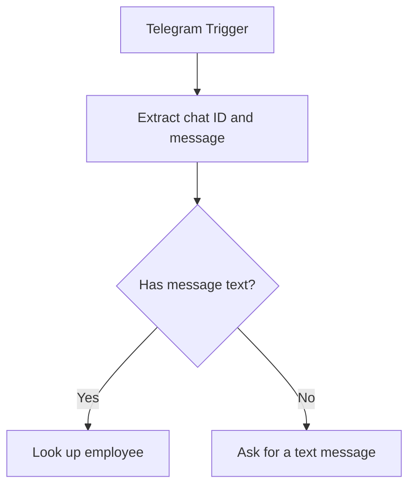

An incoming photo has a chat ID but can have no message text. The text check gives the sender a useful reply and ends that execution before it can open a meeting request.

### 2. Employee Access & Team Lead Lookup

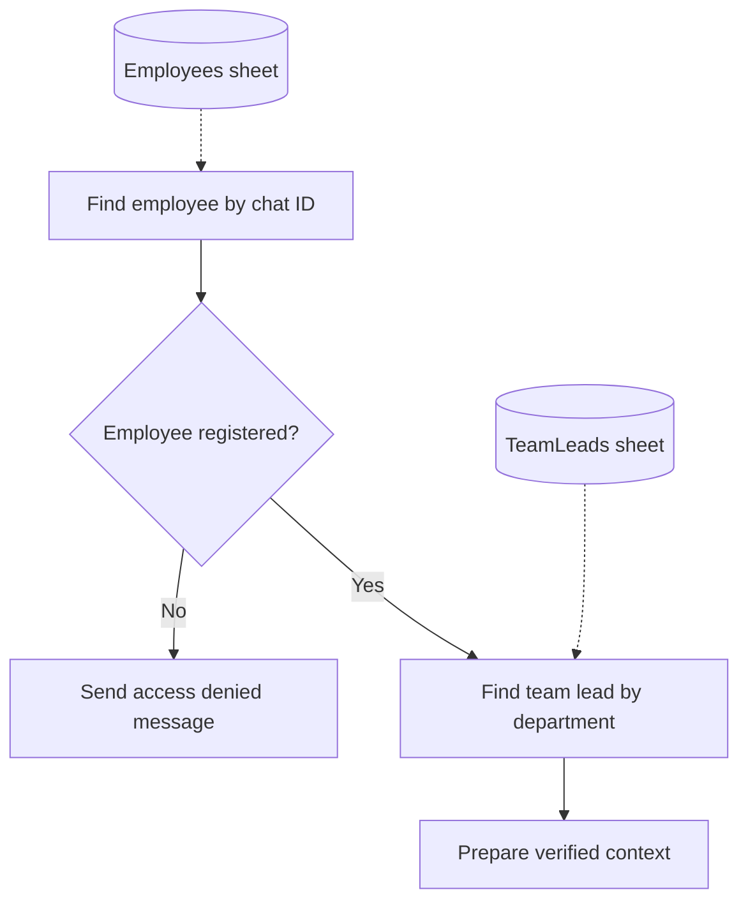

The employee’s private chat identifies their directory row. The department on that row determines the lead, email address, and calendar used downstream. Asking for another department’s lead in chat cannot change that assignment.

### 3. Meeting Session Management

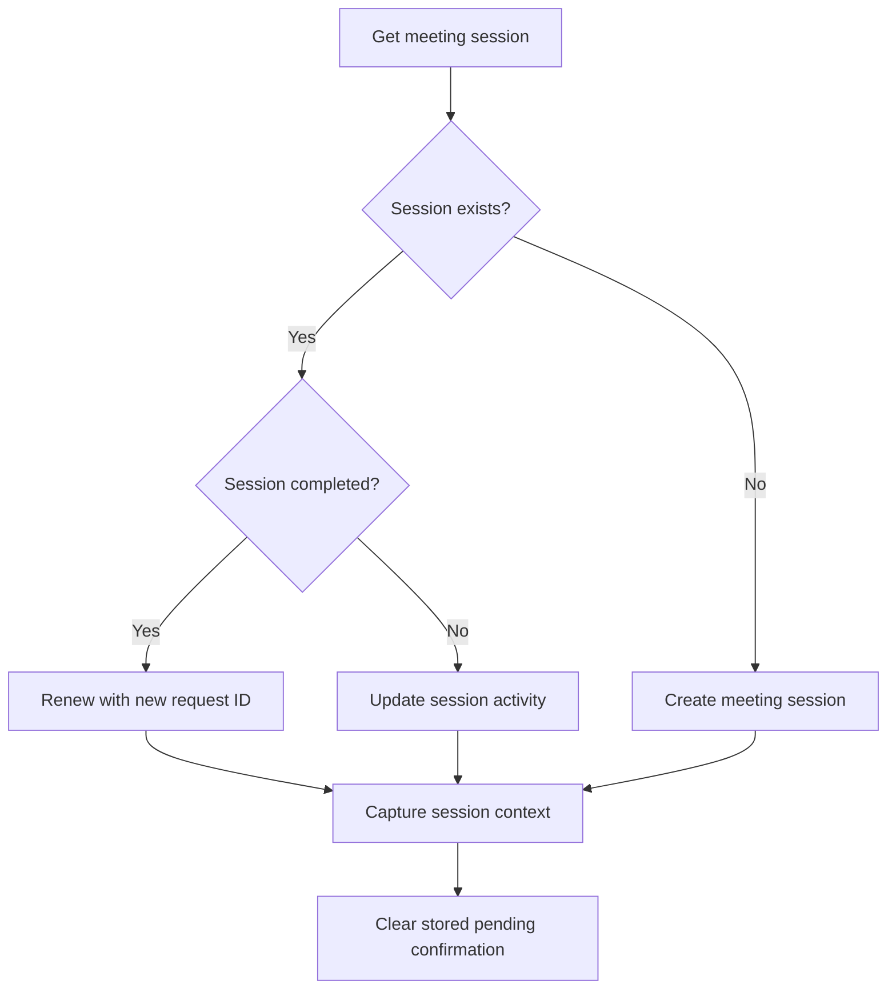

One chat can make several requests over time. An active request keeps its request ID while the employee adds details. A completed row can be reused with a new request ID. On each turn, **Session Context** captures the previous proposal before the workflow clears the stored fields. The confirmation validator can then check what the employee was answering.

### 4. AI Conversation & Response Formatting

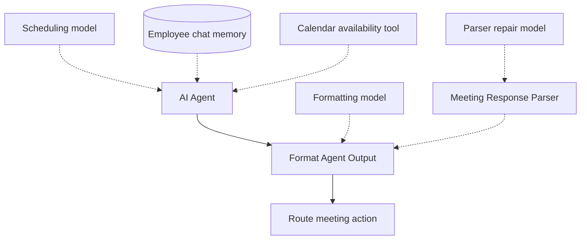

Chat memory lets the agent interpret a message such as “same purpose, but start at 11:15.” A separate formatter emits six strings that the workflow can inspect: `action`, `reply`, `startTime`, `endTime`, `eventTitle`, and `eventDescription`. The start and end timestamps carry the Cairo UTC offset for the meeting date.

### 5. Action Routing & Conversation Reply

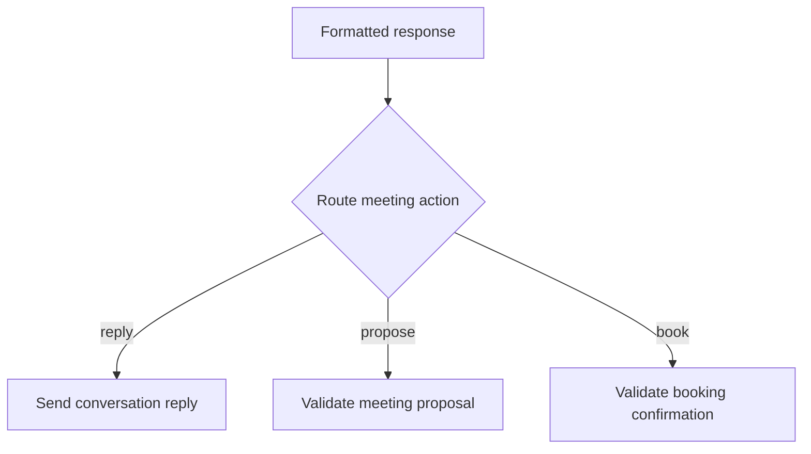

A greeting or a question about missing details ends with a Telegram reply. A proposed time enters the review branch. A booking action enters the confirmation checks, even when the model interprets the message as approval.

### 6. Meeting Proposal & Approval Request

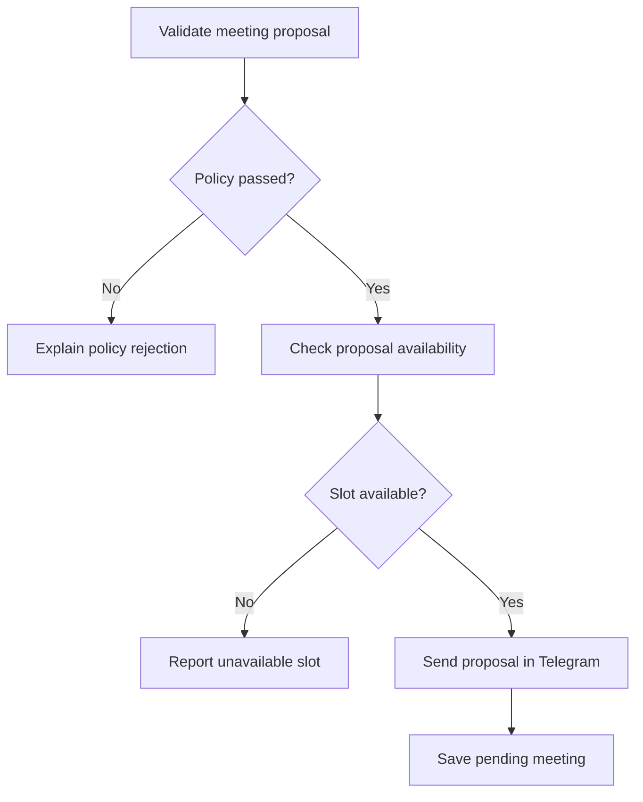

The entire meeting must fit within **09:00–17:00, Sunday through Thursday, Africa/Cairo**, on a single day and in the future. Duration defaults to **30 minutes**. After a successful check, the employee sees the lead, purpose, date, start, end, duration, and timezone. The workflow saves the proposal it sent, including the request, chat, calendar, and execution IDs.

### 7. Booking Confirmation & Final Checks

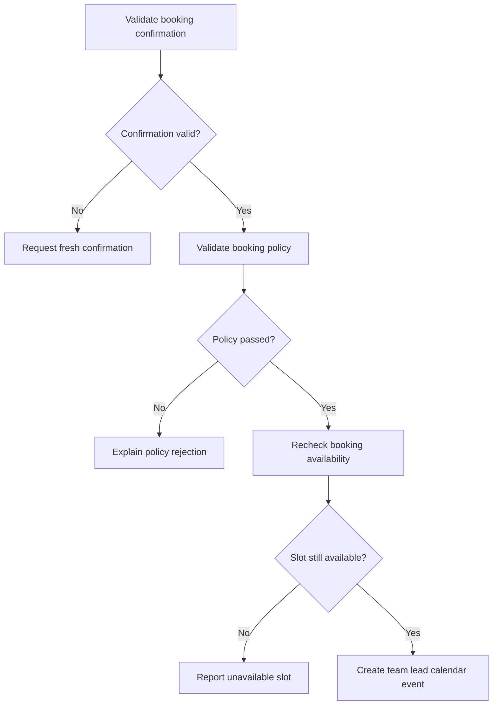

“Yes, book it” is accepted only for an active request with a matching pending proposal from an earlier execution. The validator compares the **start, end, title, and description**, as well as the request, chat, and calendar. The second availability check handles the interval between sending the proposal and receiving approval, when someone else could have taken the slot.

### 8. Event Creation, Notifications & Session Completion

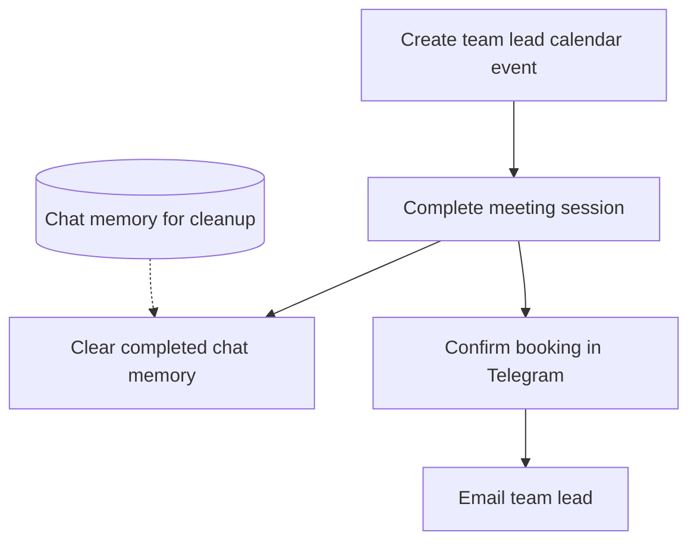

Calendar creation is the point at which the booking succeeds. The workflow marks the session completed before sending either notification. This ordering came from a test where the event existed but a Gmail credential failure left the request active.

## Booking walkthrough

The demo follows one **onboarding checklist review** from the first request to the saved Calendar event.

| Turn | Employee action | Observed result |
| --- | --- | --- |
| 1 | Requests Friday, 27 November 2026 at 11:00 AM. | The assistant explains the working-day rule. [View exchange](docs/images/intake-and-policy.png) |
| 2 | Changes the date to Monday, 30 November, keeping the purpose and time. | The assistant proposes 11:00–11:30 AM with Omar Hassan. |
| 3 | Asks to start at 11:15 instead. | The revised proposal keeps the agenda and duration and moves the end to 11:45 AM. |
| 4 | Replies “Yes, book it,” then sends the same reply again. | The first reply confirms the booking. The second receives a “no pending proposal” response. [View exchange](docs/images/confirmation.png) |

**The revised proposal**

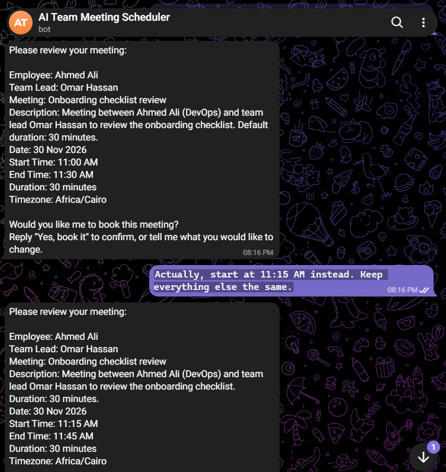

**The resulting calendar event**

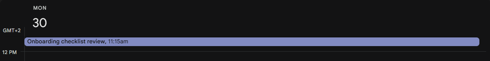

The completed session shows the final state of the request: completed status, an unchecked confirmation flag, and an empty pending proposal. A separate end-to-end run also verified email delivery to the team lead. [View session row](docs/images/completed-session.png)

## Technology stack

| Component | Responsibility |
| --- | --- |
| n8n | Workflow orchestration, branching, JavaScript policy and confirmation checks |
| OpenAI | GPT-5 for conversation, GPT-5 mini for formatting, GPT-4o mini for parser repair in the export |
| Telegram | Private employee messages, proposals, and booking confirmations |
| Google Sheets | Employee identity, department, and assigned lead directory |
| n8n Data Tables and Simple Memory | Persistent request state and recent conversation for each chat |
| Google Calendar and Gmail | Availability checks, event creation on the lead’s calendar, and email notification |

## Problems addressed during development

| Observation | Implementation change |
| --- | --- |
| A screenshot was interpreted as an empty scheduling request. | Validate text before employee lookup and session creation. |
| A Friday meeting reached the confirmation prompt in an early run. | Run policy validation before the workflow sends a proposal, and again before booking. |
| The agent repeatedly checked an interval and reached its iteration limit. | Clarify how the agent should use the tool result. Keep explicit Calendar checks at proposal and booking time. |
| An email error left an already-booked request active. | Move session completion immediately after Calendar event creation. |

## Run the project

1. **Prepare n8n and the service accounts.** Use an instance with Data Tables and the AI nodes in the export. Connect a Telegram bot, an OpenAI API account with access to the selected models, and Google credentials for Sheets, Calendar, and Gmail. A self-hosted Telegram trigger needs a public HTTPS webhook.
2. **Populate the directory.** Import [Employees.csv](examples/Employees.csv) and [TeamLeads.csv](examples/TeamLeads.csv) into separate Sheets tabs. Keep the headers. Store the employee’s private Telegram chat ID as text, match the department across both rows, and enter a test calendar the Calendar account can read and write.
3. **Create an empty Data Table** named `MeetingSessions` in the workflow’s n8n project. Add the six columns below.
4. **Import and bind the workflow.** Import the [workflow JSON](workflow/ai-team-meeting-scheduler.json). Select the spreadsheet and corresponding tabs in the two directory lookups. Select `MeetingSessions` in the Data Table nodes. Assign credentials to the trigger, Telegram send nodes, Google integrations, and model nodes.
5. **Test a complete conversation.** Activate the configured workflow or listen for each test message. From the registered chat, request a free slot on a future working day, revise it, and reply “Yes, book it.” Check the calendar, lead’s inbox, and session row.

| MeetingSessions column | n8n type | Stores |
| --- | --- | --- |
| `chatId` | String | Private chat associated with the row |
| `requestId` | String | Current request within that chat |
| `status` | String | Active or completed state |
| `lastActivityAt` | Date/time | Latest recorded request activity |
| `awaitingConfirmation` | Boolean | Whether the employee has a proposal to approve |
| `pendingMeeting` | String | Serialized proposal, identity references, execution ID, and send time |

## Scope and future work

V1 schedules a new event on the **assigned team lead’s calendar**. Employees can revise a proposal until they approve it. Editing a booked event, sending attendee invitations, and checking the employee’s own calendar are outside V1.

For a company deployment, the next priorities are a Teams or Slack entry point backed by the company directory, a durable booking record that handles simultaneous approvals, and independent retries for failed notifications. The repeated-confirmation demo covers two successive messages. Handling overlapping executions requires an atomic claim on the pending booking.

---

**AI Team Meeting Scheduler · Version 1 · Saif Elnagar**
