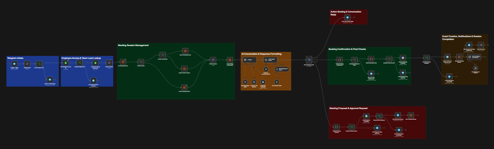
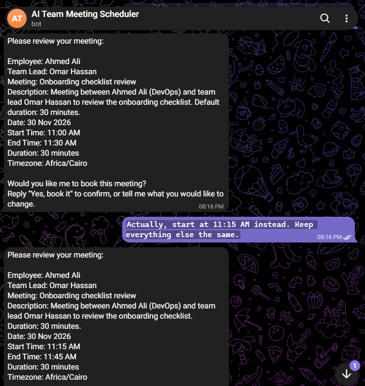

# AI Team Meeting Scheduler

A Telegram scheduling assistant built in n8n. A registered employee can ask for a meeting in plain English, change the proposed time, and approve the final details. The workflow looks up the assigned team lead, checks their Google Calendar, creates the event after confirmation, and emails the lead.

**Version 1 · Saif Elnagar** · [Workflow JSON](workflow/ai-team-meeting-scheduler.json) · [Setup](#setup) · [Booking demo](#booking-demo)

## Booking demo

An employee requested an onboarding checklist review for Friday, 27 November 2026. The assistant explained the Sunday–Thursday policy. When the employee chose Monday, it retained the purpose and proposed the default 30 minutes. The employee then moved the start from 11:00 to 11:15. The revised proposal showed **30 November, 11:15–11:45 AM Cairo time**.

| Evidence from the demo | Observed result |
| --- | --- |
| [Intake and Friday request](docs/images/intake-and-policy.png) | The assistant addressed the verified employee, identified the assigned lead, and explained why Friday was outside policy. |
| [Approval and repeated approval](docs/images/confirmation.png) | The first approval produced a booking confirmation. A later “Yes, book it” received a reply explaining there was no pending proposal. |
| [Google Calendar](docs/images/calendar.png) | The onboarding checklist review appears at the revised 11:15 AM start. |
| [Session after booking](docs/images/completed-session.png) | The session shows completed status, an unchecked confirmation flag, and an empty pending proposal. |

In a separate V1 acceptance run, the project owner also verified successful Gmail delivery, calendar booking and session completion. The repeated-approval test covers successive messages. Simultaneous confirmations and provider retries require additional safeguards.

## How a message becomes a booking

| Stage | Responsibility |
| --- | --- |
| Telegram intake | Extract the private chat ID and message text. Respond to unsupported media before it reaches the AI. |
| Employee access | Look up the Telegram chat in **Employees**, then resolve the department in **TeamLeads**. Prepare Context provides verified identities and the calendar ID to later nodes. |
| Session management | Look up the chat in **MeetingSessions**. Create a row for a new chat, update activity on an active request, or renew a completed row with a new request ID. Snapshot the prior confirmation state before clearing the stored proposal for this turn. |
| AI and formatting | The scheduling agent uses conversation memory and a calendar availability tool. A formatter and structured parser produce six strings: `action`, `reply`, `startTime`, `endTime`, `eventTitle` and `eventDescription`. |
| Action routing | A Switch sends `reply` directly to Telegram, `propose` to proposal validation, and `book` to confirmation validation. |
| Proposal | Validate time and policy, check availability, send the summary, then save the exact proposal that was sent. |
| Booking | Check the employee’s acceptance against the saved proposal, request, chat, calendar and meeting fields. Recheck policy and availability before creating the event. |
| Completion and notifications | After Calendar creates the event, mark the session completed. From there the workflow clears chat memory and sends Telegram confirmation followed by the lead’s Gmail notification. |

**Scheduling rules.** All times use Africa/Cairo. The full meeting must fit on one future working day, Sunday–Thursday, between 09:00 and 17:00. Duration defaults to 30 minutes. V1 schedules with the assigned lead and writes to that lead’s calendar. Cancellation, rescheduling an existing event, and checking the employee’s own calendar are outside V1.

## Setup

1. **Prepare n8n.** Use an instance with Data Tables, the AI Agent, OpenAI chat models, and Google and Telegram integrations. For self-hosting, provide a public HTTPS webhook URL reachable by Telegram. Use private bot chats and a dedicated test calendar for initial setup.
2. **Create the directory.** Import [Employees.csv](examples/Employees.csv) and [TeamLeads.csv](examples/TeamLeads.csv) into separate Google Sheets tabs named **Employees** and **TeamLeads**. Keep the headers exactly as supplied. Format `telegram_chat_id` as plain text, then replace the sample chat ID, emails and calendar ID with your own test values. Use one employee per private chat and one lead per department. Match the department text across tabs.
3. **Create the session table.** In the same n8n project create **MeetingSessions** with the columns below. Start with no rows. n8n manages the row ID and creation/update timestamps.
4. **Import the workflow.** Import the [JSON file](workflow/ai-team-meeting-scheduler.json) as a new workflow. The public template is inactive and its resource selectors are intentionally blank. In **Find Employee by Chat ID** and **Find Team Lead by Department**, choose your spreadsheet and the matching tab. In every Data Table node, select **MeetingSessions** and check the column mappings.
5. **Connect credentials.** Assign the same Telegram bot credential to the trigger and Telegram reply nodes. Connect Google Sheets for directory reads, Google Calendar for availability and event creation, Gmail for the sending account, and OpenAI for the three model nodes. The Calendar account needs access to the calendars listed in the directory, including permission to create events. The exported model choices are GPT-5 for scheduling, GPT-5 mini for formatting and GPT-4o mini for parser repair. Check access in your own account.
6. **Verify with a new date.** Send a text request from the registered test chat for a free future working-day slot. Check the proposal, then send “Yes, book it”. Verify the Calendar event, email, and completed session. Enable the workflow for ongoing use after this check. The demo dates above are historical examples.

| MeetingSessions column | Type | Use |
| --- | --- | --- |
| `chatId` | String | Find the session for a Telegram private chat. |
| `requestId` | String | Distinguish a new request from an earlier one in the same row. |
| `status` | String | Track active and completed requests. |
| `lastActivityAt` | Date/time | Record the latest activity on the request. |
| `awaitingConfirmation` | Boolean | Indicate that a proposal has been sent and can be approved. |
| `pendingMeeting` | String | Store the serialized proposal and its request, calendar and execution context. |

## What changed during testing

- **Missing identity after a table lookup.** The agent now reads employee and lead details from Prepare Context, so table operations can return their own row without losing the verified identity.
- **Duplicate session rows.** The lookup uses a trimmed string chat ID. An existing active request updates the same row. A later request can renew a completed row.
- **Repeated availability calls.** After an execution hit its iteration limit, the tool instructions were refined to use one result for an interval within a turn. A successful proposal and booking followed. The final workflow still performs independent availability checks on the proposal and booking branches.
- **Approval of revised details.** A stored proposal ties approval to the meeting the employee reviewed. Changing the start time requires another proposal. The demo shows the revised time in Calendar.
- **A Gmail failure left a booked session active.** Event creation now leads directly to session completion before notification delivery. The email subject and meeting times use parsed fields from Format Agent Output.

## Production considerations and future work

For a company rollout, adapt the intake and reply nodes to its chat platform, and resolve employee-to-manager assignments from its directory. Agree on time zones, attendee invitations and whose calendars must be available.

V1 uses a reusable session row and a separate calendar write. For concurrent requests or retryable delivery, add a durable booking record with a stable event identifier, deduplicate incoming messages, and claim each confirmation atomically. Track notification delivery separately so an email failure can be retried without creating another event. Add proposal expiry, backups, monitoring and an error-alert owner for an always-on deployment.
